# Build a library with GitHub Actions

This guide explains how to use GitHub Actions to build the library without
installing Rust or a JDK on your computer.

## 1. Create a private repository

Create a GitHub account if you do not already have one, then create a private
repository. Keeping it private prevents your mod JAR and build outputs from
being publicly visible.

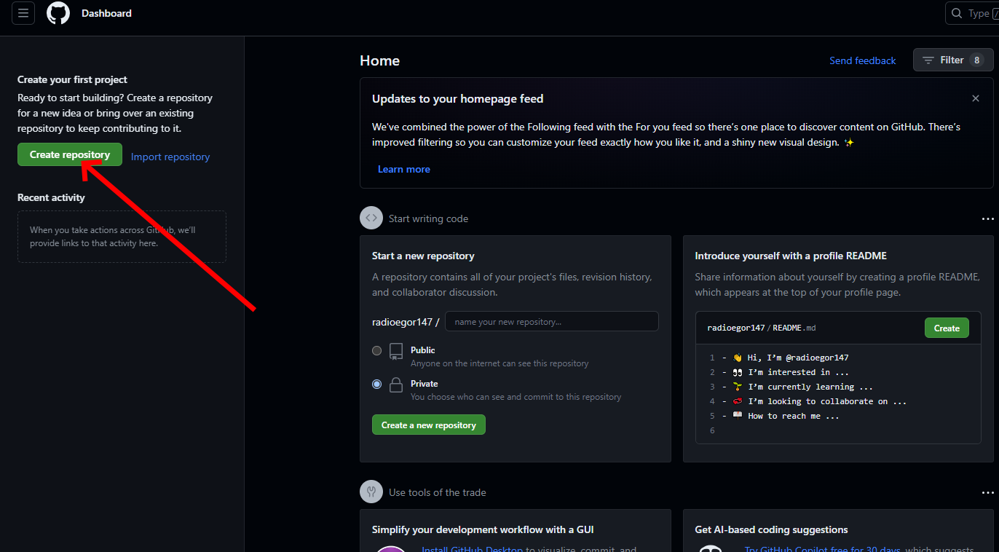

Choose a repository name and select **Private**.

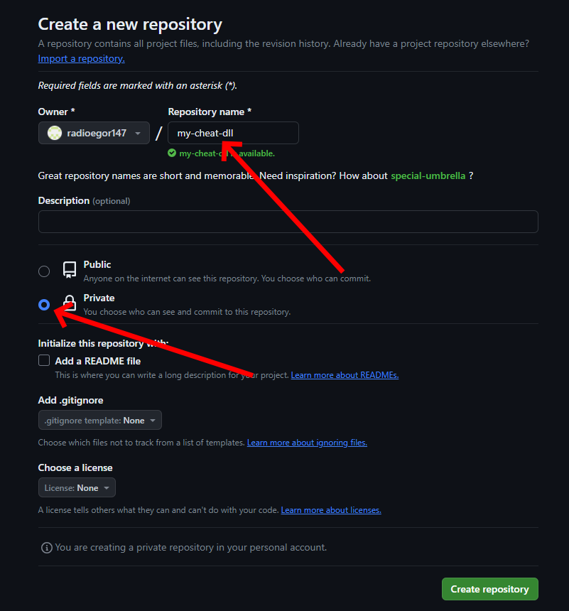

## 2. Import this project

Use GitHub's **Import repository** feature to copy this project into your
private repository.

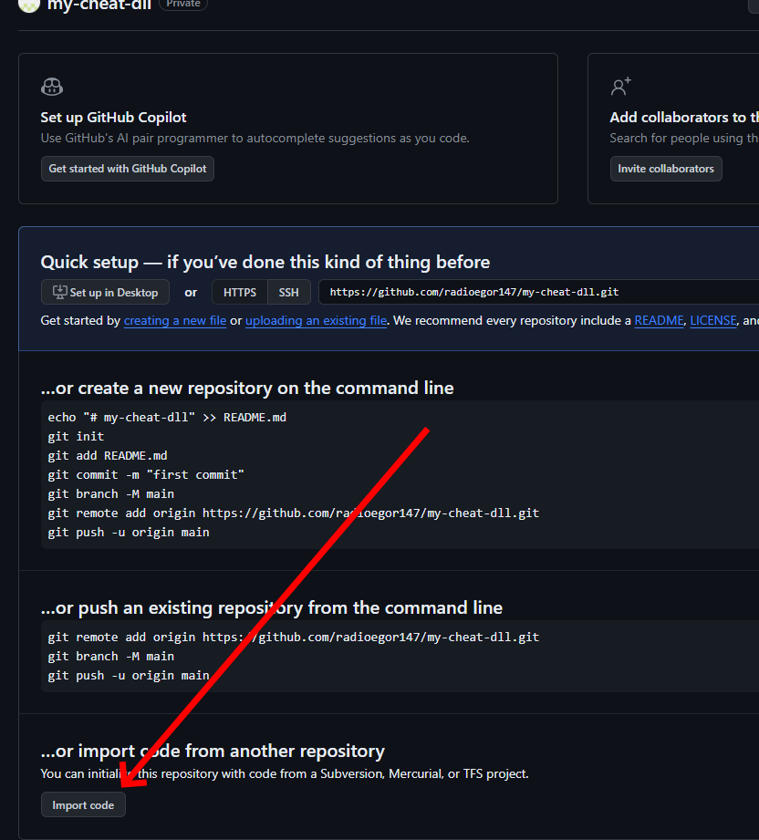

Enter the URL of this repository.

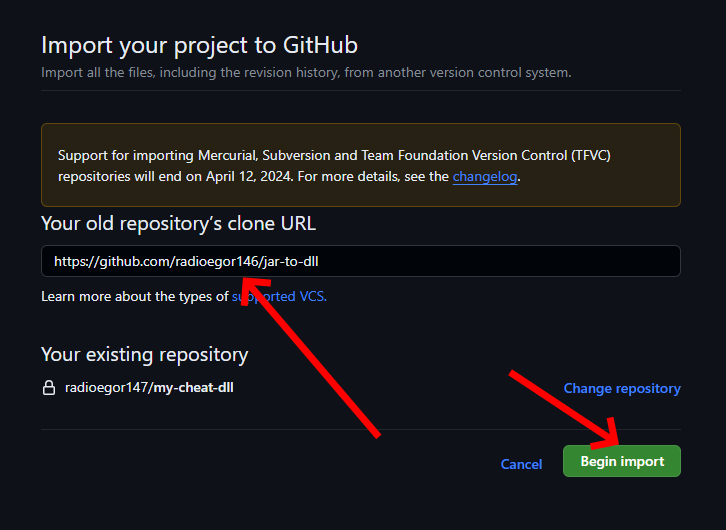

Wait for the import to finish.

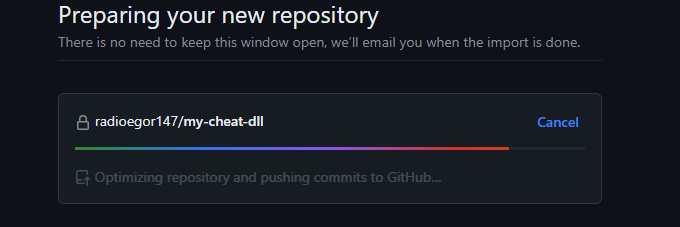

Open the imported repository.

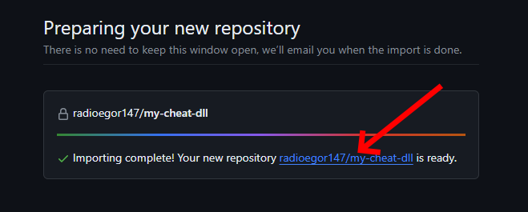

## 3. Enable GitHub Actions

Open **Settings**.

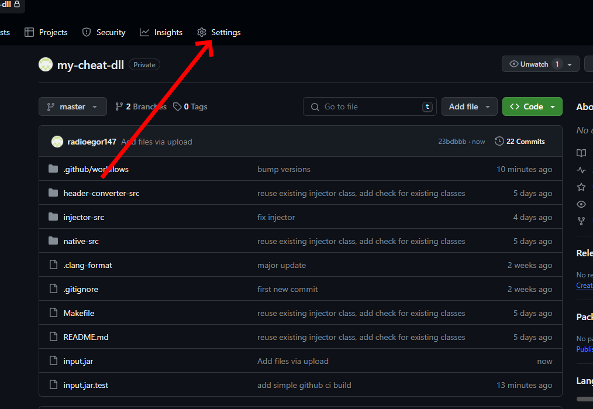

Select **Actions**.

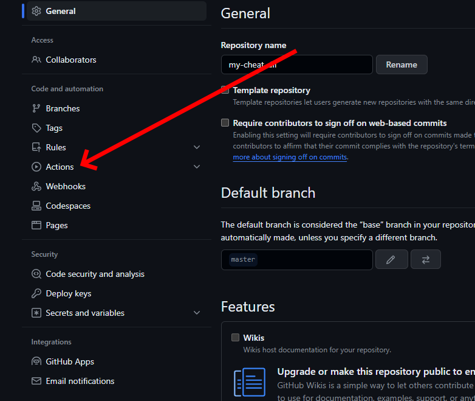

Select **General**.

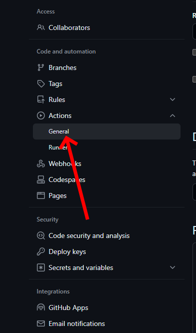

Allow the actions used by the repository.

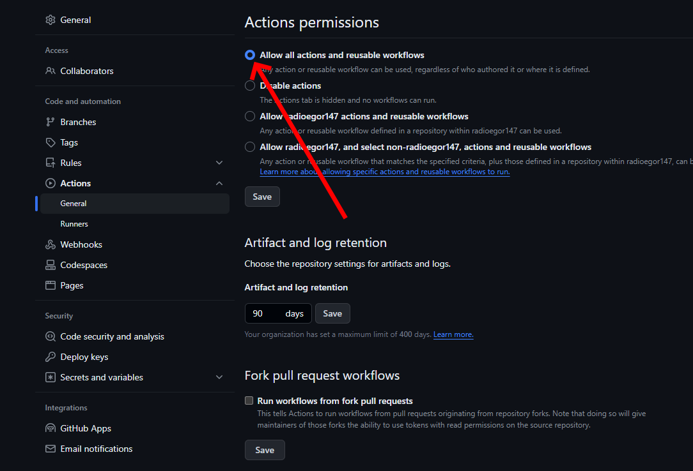

Open the **Actions** tab and enable workflows for the repository.

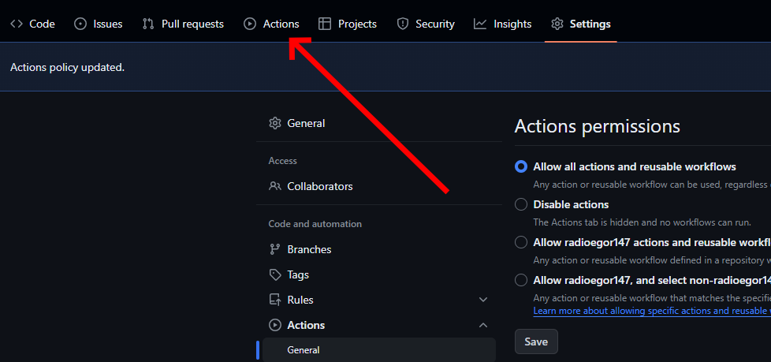

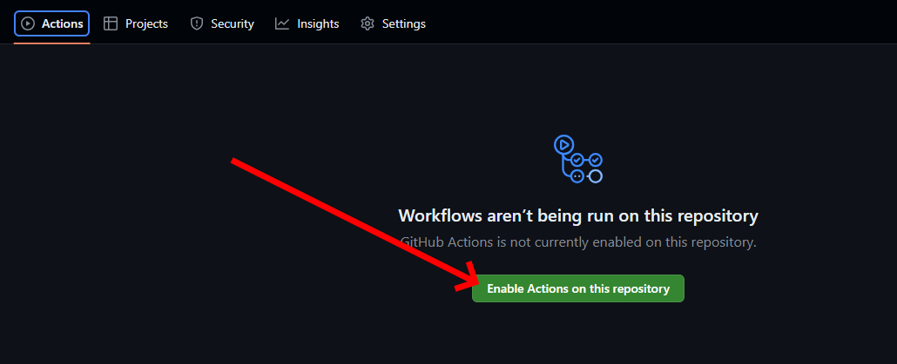

## 4. Add your mod JAR

Open the **Code** tab.

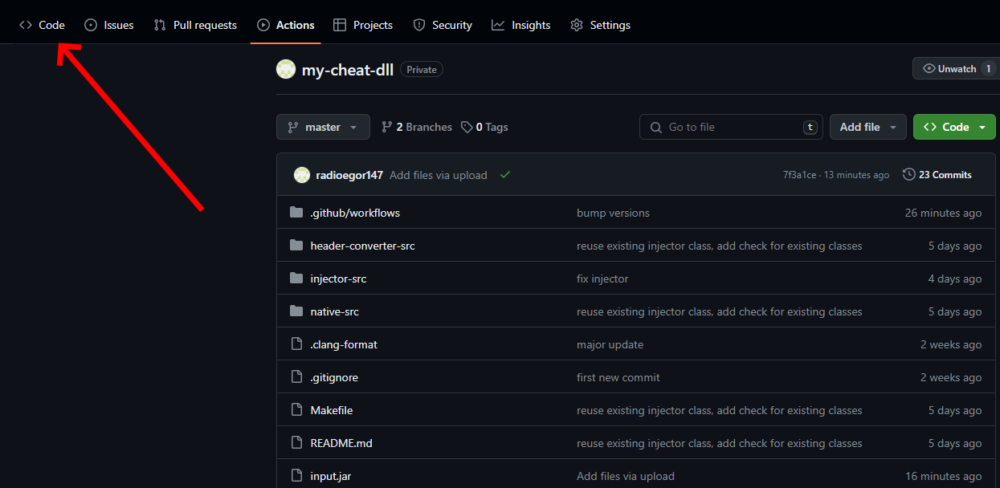

Choose **Add file**.

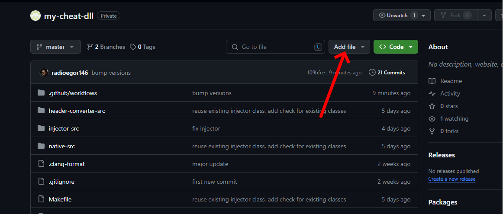

Choose **Upload files**.

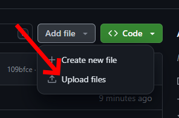

Upload your mod `.jar` file. You do not need to rename it to `input.jar`.

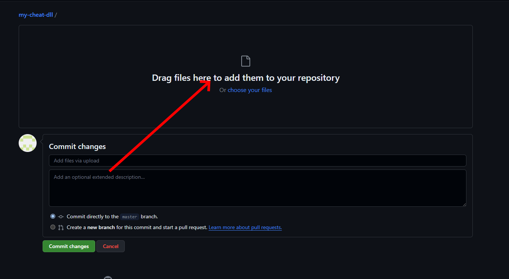

Commit the uploaded file to the repository.

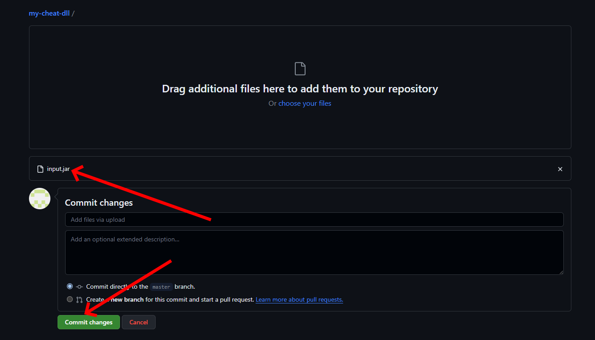

## 5. Run the build and download your library

Open the **Actions** tab.

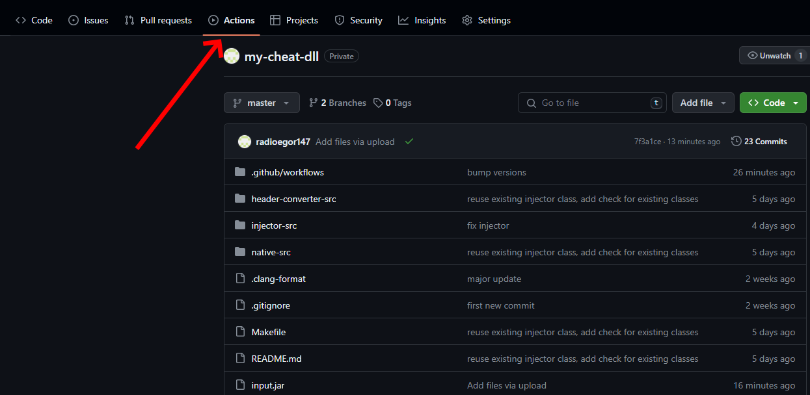

Select the running build workflow.

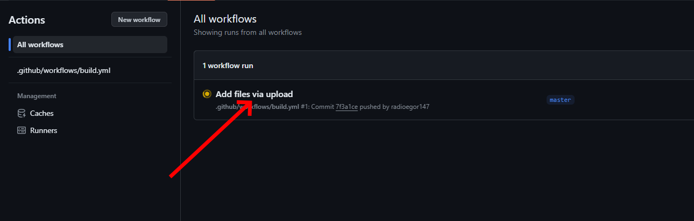

Wait for the build to complete.

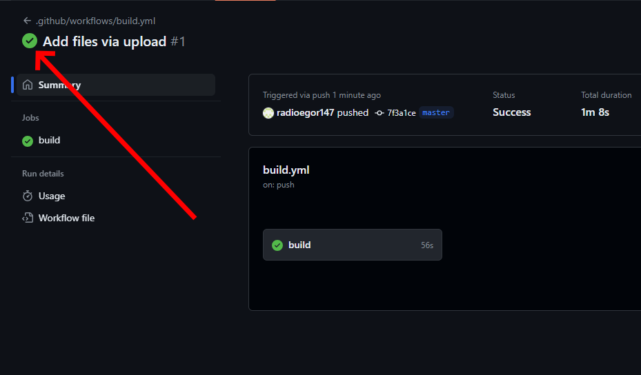

Download the artifact for your platform from the completed workflow run:

- `jar-to-dynamic-library-windows-x64` contains the `.dll`.
- `jar-to-dynamic-library-linux-x64` contains the `.so`.
- `jar-to-dynamic-library-macos-arm64` contains the Apple Silicon `.dylib`.
- `jar-to-dynamic-library-macos-x64` contains the Intel `.dylib`.

The screenshot below may show an older artifact name.

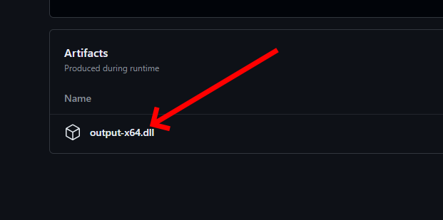

Keep the repository private if you do not want your JAR or build artifacts to
be public. The native library must still be loaded into the Minecraft process
separately; this workflow only creates the library.
